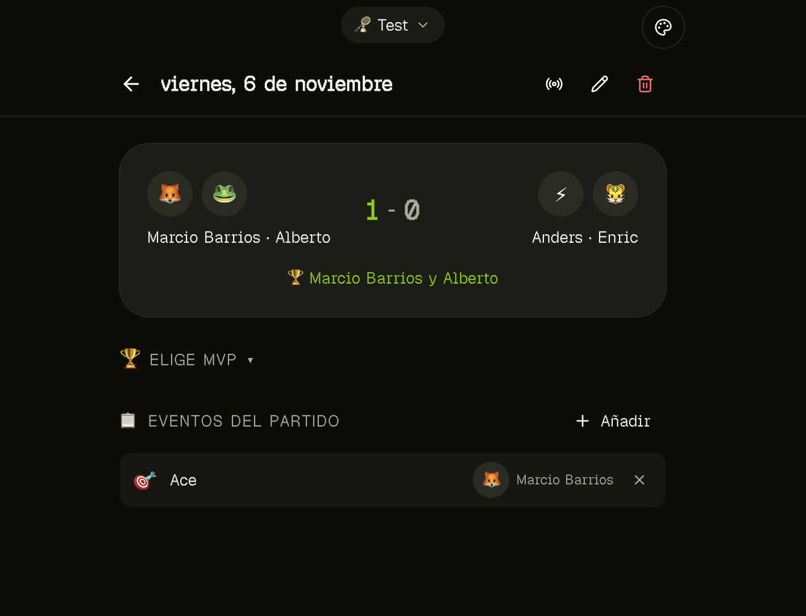

# MAR-44 local evidence — 6 November 2026

The device run used working-tree sources on base `faea8db`; the implementation
is preserved in commit `5fbeb974d847475b1f2cb16f96c6019b439f86f2` (publication
cleanup removed only a trailing blank line from the tested Swift sources).
This document records
local build and incremental physical-device evidence; MAR-44's full
TestFlight/physical-device criteria remain pending. Local development signing
and installation are verified below.
A hosted test match was prepared through the web UI with owner approval as
recorded below. The owner reported the Watch's server confirmation for one
score action and one event action, confirmed the iPhone stayed locked during
both, and supplied a web screenshot showing the expected final state. The
core locked-phone experiment passed on locally signed Release build 3.
TestFlight, additional resilience scenarios, paid-program enrollment, cloud build
and upload remain deferred or unperformed.

## Verified locally

| Check | Result |
| --- | --- |
| Toolchain | Xcode 27.2 / 27B52, iOS/watchOS SDK 27.2, CocoaPods 1.17.0, pnpm 11.20.0, Node 24.19.0 |
| Lockfile | Frozen install with scripts disabled passed; no new script-policy exceptions |
| Dependency compatibility | `expo install --check` passed |
| Mobile checks | ESLint, TypeScript and 7 Node configuration tests passed |
| Native safety tests | 12 Swift XCTest cases passed on macOS; URLProtocol fixtures, no hosted requests |
| Test sensitivity | Inverting the duplicate-attempt guard failed the suite; original source restored and 8 tests passed |
| Mobile bundles | iOS and Android Hermes bundle export passed |
| Watch simulator target | Standalone unsigned Release build passed |
| Watch device SDK target | Unsigned Release compilation for watchOS passed after clean test-variant generation; not installed or signed |
| Combined phone + Watch | Unsigned Release build for generic iOS Simulator passed |
| iPhone device SDK build | Unsigned combined Release build for generic iOS passed before the signed device build |
| Signed device build | Initial Release build `0.1.0` / `2` passed; final build `3` also passed and was installed on both devices for the locked-phone run |
| Signature verification | `codesign --verify --deep --strict` passed for the signed app bundle |
| Physical iPhone installation and launch | Device installer reported success for `com.padelaso.mobile.test`; owner confirmed it opens after trusting the developer certificate |
| Physical Watch discovery | After pairing with Mac `mm4`, Device Hub and Xcode list `AW11`, Apple Watch Series 11, watchOS 27.0; diagnostics confirm Developer Mode and DDI services enabled |
| Watch-specific signing | Release build targeted AW11 successfully; verified profile now includes both phone and Watch UDIDs |
| Physical Watch installation and launch | Device installer reported success for `com.padelaso.mobile.test.watch` on AW11; owner confirmed the app opens and asks for iPhone setup |
| Watch installation inventory | Final device inventories confirm `Padelaso Test` version `0.1.0`, build `3`, on phone and Watch as developer apps |
| Refreshed companion bundle | Phone rebuilt successfully with AW11 in the embedded Watch profile; deep signature verification passed and the refreshed phone app installed successfully |
| Native iPhone setup form | Owner confirmed Configuración → Preparar prueba del Watch opens the native form |
| Hosted test baseline | Created match `179c413d-7ee9-4f8c-9923-8ae599946d63` in existing `Test` group; web UI verified 0–0 and no events |
| Test credential target | Owner explicitly approved redirecting the existing permanent token; web Scorekeeper verified “Atajo activo para este partido”; token value was unchanged and is not recorded here |
| Native context transfer | Owner reported the Watch receipt; copied allowlisted iPhone diagnostics verify `stage: confirmed`, with supported/activated/paired/appInstalled all true |
| Watch hosted options | Owner reported “Partido verificado. Un intento por acción” after loading options; player and event pickers both open and work. This verifies the read-only setup step, not a score/event mutation |
| Watch score action | Owner reported “Servidor confirmó envío…” after one Equipo 1 increment and confirmed the iPhone stayed locked. Supplied web screenshot shows Marcio Barrios + Alberto 1–0 Anders + Enric |
| Watch event action | Owner reported “Servidor confirmó envío…” after one Ace for Marcio Barrios and confirmed the iPhone stayed locked. Supplied web screenshot shows exactly one event row: Ace, Marcio Barrios |
| Locked-phone reconciliation | Passed on locally signed Release build 3: creation baseline 0–0/no events, final 1–0/one Ace. Evidence combines owner-reported physical interactions and lock state with the inspected [web screenshot](evidence/mar44-locked-phone-result.webp); no live database query or device recording was captured |
| Artifact inspection | Phone `.app` contains `main.jsbundle` and `Watch/PadelasoWatch.app`; final build `3` has matching versions, correct companion ID and `WKApplication=true`; deep signature verification passed |
| Clean regeneration | Two clean test-variant generations passed after the XML-parser override; handwritten native-source hashes unchanged |
| Generated version alignment | Generated phone and Watch build settings both `3`, matching `com.padelaso.mobile.test` / `.test.watch`, embedding and watchOS 10 deployment verified; increase the number before a new upload |
| Source ownership | Swift, plist, target config, module, podspec and build-number plugin are outside ignored generated projects |
| App icon source | Opaque 1024 × 1024 PNG, approximately 16 KB; target asset catalogs generated |

Native tests cover invalid/unknown setup, credentials in headers rather than
URLs, exact score/event request bodies, changed active match, redirect refusal,
timeout without an application retry, unknown-attempt persistence and duplicate
blocking across token rotation/relaunch. Fixture tests do not exercise real
Keychain persistence, WatchConnectivity delivery, watchOS suspension, signing,
or hosted endpoint behavior. Those require the device experiment.

Build logs from this run are under `/tmp/padelaso-mar44-*`; they are local,
temporary artifacts, not committed evidence. The combined Release build used:

```bash
xcodebuild -workspace apps/mobile/ios/PadelasoDev.xcworkspace \
  -scheme PadelasoDev -configuration Release \
  -destination 'generic/platform=iOS Simulator' \
  -derivedDataPath /tmp/padelaso-mar44-phone-build \
  CODE_SIGNING_ALLOWED=NO build
```

The build emitted upstream React Native/Expo deprecation/nullability and
script-phase warnings. Initial verification caught and fixed an unavailable
Watch text-selection API, CocoaPods excluding shared sources outside its root,
and the generated phone project build number staying at `1` when the Watch
advanced to `2`. A forced phone `-sdk` also incorrectly overrides the Watch SDK;
the successful combined command selects the platform by destination instead.

## Physical results and remaining gates

- **Signing:** the owner selected the same **Personal Team** for both targets.
  One valid Apple Development identity is now installed. The signed build
  succeeded with automatic provisioning, and both bundles contain development
  profiles expiring **13 November 2026**. The team ID is preserved in ignored
  `apps/mobile/.env.local`; no certificate/private key/profile was committed.
  App Store Connect and an Expo project are not configured.
- **Physical hardware:** the owner confirmed an iPhone and Watch are available,
  and command-line discovery now detects the wired, paired iPhone 18 Pro on
  **iOS 27.0.1**. After the owner enabled Developer Mode and restarted, current
  diagnostics verify **Developer Mode enabled** and **DDI services available**.
  The signed phone app has now been installed successfully. The device tool
  still exposes only simulators/emulators. The owner confirmed the physical
  phone app opens after trusting the development certificate; this is
  owner-reported launch evidence, not an observed full UI smoke test.
  The signed Watch app has also been installed successfully. The owner
  confirmed it launches. Context transfer is corroborated by the iPhone
  diagnostic receipt; the owner also confirmed hosted options load on the
  Watch. One score action and one event action each have an owner-reported
  server confirmation. The owner confirmed the iPhone stayed locked during
  both and supplied the reconciled web result below.
- **UI smoke:** the Release app was installed on the iPhone 18 Pro / iOS 27.2
  simulator, but opening it returned `DEVICE_IN_USE`. Initial and user-requested
  retries (including a 10-second wait) returned the same error. The existing
  session was neither reused nor closed.
  The owner exercised the native setup form and Watch selectors on physical
  hardware. Automated navigation, VoiceOver and large-text checks remain unrun.
- **Watch runtime:** no Watch simulator was exposed by the device tool. Watch
  compilation is not evidence of rendering or WatchConnectivity delivery.
  The owner attempted installation through the iPhone Watch app: progress
  advanced and returned to **Install**, without a visible error. At that point,
  Xcode's Watch scheme listed no physical Watch and the embedded Watch profile
  contained only the phone UDID. This was a suspected cause, not an observed
  install rejection. The owner then enabled Watch Developer Mode and completed
  pairing with Mac `mm4` using Device Hub's temporary code. Device Hub,
  `devicectl` and Xcode now discover **AW11 / Apple Watch Series 11 / watchOS
  27.0**. Diagnostics confirm Developer Mode and DDI services enabled. A signed
  build targeting this physical Watch passed, and its refreshed profile now
  includes both the phone and Watch UDIDs. Direct installation on AW11 then
  succeeded, and the Watch installed-app inventory confirms version `0.1.0` /
  build `2`. The phone was rebuilt to embed the corrected Watch profile,
  verified with `codesign --verify --deep --strict`, and installed successfully.
  The owner confirmed Watch launch with the initial iPhone-setup prompt.
  Targeted device log
  collection required root access, which was unavailable; no install-log error
  has been captured.
- **TestFlight:** no distribution archive, validated upload, processed build or
  TestFlight install exists. The configured profile has not been submitted.
  The owner prefers to defer TestFlight until the iOS app is further along;
  prioritize local signed physical-device testing first. MAR-44's original
  distribution criterion remains pending.
- **Transport:** test setup now uses origin `https://app.padelaso.com` and match
  `179c413d-7ee9-4f8c-9923-8ae599946d63`: **Marcio Barrios + Alberto** versus
  **Anders + Enric**, in the existing **Test** group. The owner approved
  repointing the existing permanent token, so any existing Shortcuts using it
  now target this test match. The web UI verified the starting score **0–0**,
  **no events**, and active token binding. Native context transfer is confirmed
  both by the owner's report and the iPhone's allowlisted diagnostic record (`stage: confirmed`;
  supported, activated, paired and appInstalled all true). The owner then
  reported “Partido verificado. Un intento por acción” on the Watch, with
  working hosted player/event pickers. A fresh web baseline check remained on
  the loading skeleton after a browser reload; the 0–0/no-events baseline
  above is the previously observed creation state.
  Following instructions to lock the iPhone and submit one Equipo 1 score
  increment, the owner reported the Watch's server-confirmed status. Following
  instructions to keep the phone locked and send one Ace for Marcio Barrios,
  the owner reported the same server-confirmed status for the event. The owner
  then explicitly confirmed both the expected web state and that the iPhone
  stayed locked during both actions. The supplied screenshot, inspected on
  6 November 2026, shows the **Test** group, **Marcio Barrios + Alberto 1–0
  Anders + Enric**, and exactly one event row: **Ace — Marcio Barrios**.
  This passes the core locked-phone scenario on locally signed Release build
  **0.1.0 / 3**. The lock state is owner-reported; the screenshot corroborates
  the final web result, without an independent database query or device video.
  Background, wrist-down, loss and relaunch scenarios in
  [WATCH-SPIKE.md](WATCH-SPIKE.md) remain pending.

- **Setup error investigation:** the owner reported the native form already
  showed an old generic failure when reopened, then cleared its token field
  without a clear result after sending. The attached screenshot shows an empty
  fresh form with that generic error; it does not establish whether the
  failure was HTTP validation, Keychain or WatchConnectivity. Build 3 adds
  progress, stage-specific safe errors, token retention on failure, cached
  setup metadata and allowlisted local diagnostics. New tests cover HTTP 401
  without retry, malformed responses, activation/pairing/install-state
  precedence and diagnostic data minimization. Inverting the activation guard
  failed the tests; the guard was restored and all 12 tests passed. Physical
  Release build **3** passed, deep signature verification passed, and device
  installation succeeded on both the iPhone and AW11. The owner then reported
  a Watch persistence receipt, corroborated by the local diagnostic record.
  The earlier failure's precise stage was not captured, so no specific root
  cause is claimed. The revised setup transfer is physically verified.
- **Repository-wide checks:** this change ran mobile checks and native builds;
  it does not claim separate web/marketing, database pgTAP or CI success.
- **Credential cleanup:** the existing permanent token still targets the test
  match. It was not rotated or revoked, and neither device setup was cleared.
  Existing Shortcuts using that token continue to target the test match until
  the owner selects another one. The original active match was not captured.



## Dependency audit

Re-audited the current and original HEAD lockfiles against the same registry.
The original reports **4 critical, 42 high, 67 moderate and 10 low** findings.
The final graph reports **4 critical, 42 high, 68 moderate and 10 low**.
The only new advisory ID is moderate `uuid` **8.3.2**, through
`@bacons/apple-targets → @bacons/xcode`; it concerns supplied buffers in
v3/v5/v6. Added app sources do not call those APIs. This is build tooling,
not an application import; this is an exposure assessment, not an exploit test.
Defer its major-version replacement to a toolchain-compatible upgrade and
recheck by **12 November 2026**, before distribution.

The generator initially added high XML-parser advisories through
`@expo/plist@0.0.18 → @xmldom/xmldom@0.7.13`. A parent-scoped pnpm override uses
patched **0.8.15**, after reviewing its changelog. Two clean generations and
project parsing verified that path. No new high/critical advisory IDs remain.
Existing baseline findings, including critical web dependencies and mobile
build-tool advisories recorded in [VALIDATION.md](VALIDATION.md), remain
unresolved. This is not release approval or a clean security audit. Remediate
the applicable baseline findings before distributing a beta.
